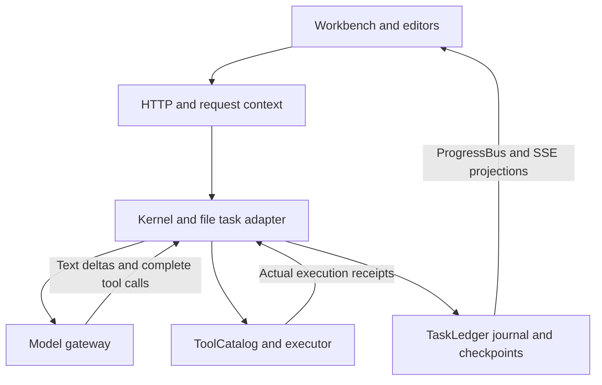

# Koto Architecture

## Overview

Koto's primary product is the independent task and document workbench: a Flask
backend with a TypeScript frontend and existing embedded document editors.
Office/WPS adapters remain compatible consumers of the shared runtime.

## Layer Map



## Key Directories

| Dir | Purpose |
|---|---|
| `launcher/` | Entry point, health checks |
| `web/` | Flask app, blueprints, workbench frontend and transport adapters |
| `web/blueprints/` | HTTP route handlers |
| `web/documents/` | Document processing (gen, compare, annotate, PDF) |
| `web/proactive/` | Triggers, suggestions, smart feedback |
| `web/knowledge/` | Knowledge graph, web search, concept extraction |
| `web/tasks/` | Whitelisted system actions, templates and operation-history compatibility |
| `web/files/` | File processing, indexing, QA, batch ops |
| `web/services/` | Chat streaming pipeline |
| `web/src/` | TypeScript workbench, editors, event rendering and UI adapters |
| `app/core/` | Domain logic |
| `app/core/agent/` | Kernel loop, file policies, scoped UI tools and validation |
| `app/core/llm/` | Configured model providers, stream normalization and cancellation |
| `app/core/tasks/` | TaskLedger state, durable event journal and checkpoints |
| `app/core/jobs/` | Background jobs, safe recovery and disconnected producer continuation |
| `app/core/services/` | Canonical service implementations |
| `config/` | API keys, requirements, feature ownership |
| `data/` | Runtime SQLite DBs, state JSON |
| `tests/` | Unit, integration, offline contract evaluation and browser tests |
| `docs/` | Documentation (archive in docs/archive/) |

## Runtime contracts

Unlocked streaming workbench requests enter the Kernel. Non-streaming chat and
Mini Chat retain their CHAT boundary. Explicit transport contracts remain authoritative.
File workflows enter the same Kernel through an adapter that preserves their
tools, file transactions, evidence checks and final quality gates. Free-form
task decisions belong to the model; transport code does not maintain a keyword
classifier.

`message.started`, `message.delta` and `message.finished` distinguish draft
increments from the final message. Tool arguments are fully assembled and
validated before execution. A final message replaces its draft rather than
appending another copy. A message finishing does not establish task success:
tool calls, retries and rejected answers also finish a message. Validation and
the unique `run.finished` establish the task outcome. Existing non-streaming
AgentStep consumers remain compatible.

TaskLedger owns durable events, cancellation, terminal states and checkpoints.
The journal assigns a sequence once per run before publication. ProgressBus
distributes those facts; SSE replay uses the same run and sequence identity.
Browser disconnection is separate from cancellation. HTTP disconnect transfers
the same producer to the existing JobRunner pool; GET replay only observes it.
A stop request is only confirmed after execution reaches a real stopping boundary.

Browser actions and their dispatch/receipt state now use the same TaskLedger
SQLite owner. Delivery requires the bound browser, request, session and token.
An unknown mutation remains blocked across restart; an execution marker alone
does not establish success. The browser persists each action's marker/receipt
independently and resends receipts without applying the edit again.

Kernel and file workflows save messages, tool results and file receipts at safe
boundaries. JobRunner resumes the corresponding adapter and keeps the original
file validation. Unknown writes are not blindly replayed. The file adapter
checks source hashes and current tool admission; host/Addon authorization is
not reconstructed from a checkpoint.

Live document tools (`ui_read_context`, `ui_apply_edit`, `ui_save`) require a
host-bound browser/document scope. They check the editor revision and return
actual execution receipts. Server source writes use optimistic SHA-256 checks,
a shared file lock, backups, atomic publication and readback verification.
Browser file handles use hash checks before writing and independent readback;
they do not share the server's lock and rollback transaction. Applied editor
changes and saved source files have separate states. DOCX semantic patches use
precise textblock scopes and one ProseMirror transaction, including bounded
multi-paragraph, list and table-cell edits. Structural insertion/deletion and
cross-cell/list operations remain explicitly bounded. Undo requires the same
live editor and exact post-edit revision; other formats retain their existing
file-task capabilities.

Legacy proposals use verified apply results as well. Missing editors, rejected
or unknown results and asynchronous failures do not become accepted proposals
or trigger source saves. Semantic editor changes mark drafts dirty without
starting disk autosave before an explicit save result.

Model calls publish content-free `model.metrics` events with backend-observed
duration, first public text latency and numeric provider usage. Context estimates
are labeled separately and never substituted for billing. Whole-turn history
compaction counts immutable history once rather than rescanning every remaining
turn. DOCX file mutations can attach host-observed before/after table structure
from the transaction snapshot, so an old table cannot prove a new table write.
Direct and streaming native DOCX mutations also check protected source
structures before commit and restore the transaction snapshot on loss. UI
source-save rejection separately retains the live draft; native rollback does
not imply that a separate draft was created.

The model Markdown boundary copies passive HTML into fresh nodes, omitting
named DOM properties, application action attributes and active namespaces.
Remote images become explicit links rather than automatic external requests.

Root-level `web/*.py` domain re-export shims have been removed. Import migrated
implementations from `app.core.services` or their canonical package owner; do
not recreate those shims. See `AGENTS.md` and `docs/STABILITY_CONTRACT.md`.

## Running

```powershell
.venv\Scripts\python.exe -m web.app
```

## Testing

```powershell
.venv\Scripts\python.exe -m pytest --ignore=tests/e2e -m "not live_api"
.venv\Scripts\python.exe scripts\standalone_acceptance.py --http-only
cd web
npm test
npm run build
```

Offline acceptance uses the actual Flask handlers, Kernel and file tools with a
clearly identified fixture provider. It verifies behavior and real file effects;
it does not establish live model quality or browser end-to-end success. Browser
tests and explicitly opted-in live evaluation remain separate gates.

Implementation and acceptance scope are documented in
`docs/plans/KOTO_COMPREHENSIVE_OPTIMIZATION_DESIGN_2026-11-15.md`; current
results and unverified runtime gates are in
`docs/KOTO_COMPREHENSIVE_OPTIMIZATION_REPORT_2026-11-15.md`.

## CI/CD

`.github/workflows/` contains 5 pipelines: lint+test+coverage, Windows build, CodeQL, pages, release.
