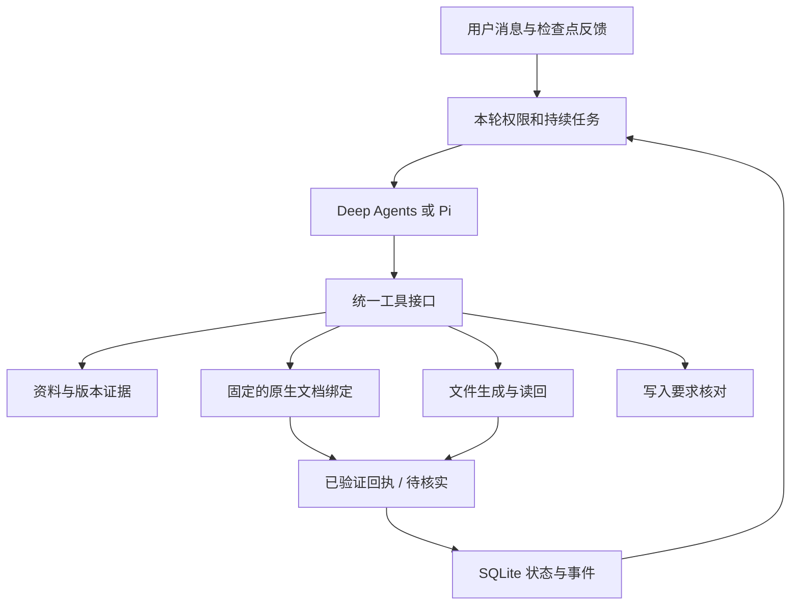

<!-- Historical record; see companion/README.md for current status. -->
# Koto Agent 下一轮设计与实现边界

2026-10-19。已实现独立验证层 `companion/agent_lab/`，主候选 Deep Agents / LangGraph，轻量对照 Pi Agent Core。正式 Office/WPS 服务和侧栏尚未切换。

## 责任划分

| 责任 | 所有者 | 完成条件 |
|---|---|---|
| 持续目标、约束、待办和交付物 | Koto TaskStore | 用户要求的结果均有可核对证据 |
| 模型与工具循环、上下文 | 选定的开源运行时 | 本轮已回答、检查点等待、明确阻塞或达到预算 |
| 资料、文件生成、宿主调用 | 统一 ToolBroker | 参数、权限、来源版本和执行回执符合约束 |
| 本轮写入意图核对 | 独立 WriteVerifier + 显式只读协议 | 最新请求允许具体动作；明确只读时硬禁写 |
| 文档读写与范围 | 现有宿主连接器 + BoundTextDocument | 固定范围写入并原生读回一致 |
| 对话和改动可见 | 侧栏消费事件 | 验证结果先保存，再显示，不以模型口头完成为准 |

## 状态规则

- 对话消息、任务目标和文档片段各有独立生命周期。只读回答保留持续目标；单片段核对成功进入 `review`，不会把未完成文件生成标记完成。
- 任务只有 `complete_task` 校验交付物、计划和文件哈希后才标记 `complete`。只读轮不开放该工具。
- 显式确认或调整可释放检查点；自动模式的每项写入仍须核对最新请求。该语义判断必须继续做回归，框架不能自动证明它永远正确。
- 动作先登记 `started`，外部执行成功且读回后登记 `verified`。同编号同内容返回旧回执；同编号改内容拒绝；未确认结果停止并核查。
- 一个任务同一时间只有一个执行者。取消递增任务代次，旧回合不能提交迟到动作。文件失败在尚未发布时可返回工具结果继续处理。
- 模型轮次、工具次数和时间有界；达到预算保留进度。费用通过用量记录评估，本轮未声称实现跨供应商精确费用限额。
- 2026-10-20：新增受独立核对的交付清单修订，用户取消或改名时保留前后版本及原始消息。计划只是执行记录，不能代替交付证明。
- 结构化分析独立于模型上下文：显式资料在内存 SQLite 中查询，完整结果持久化为内容哈希编号；预览与全量数据分开，导出前重新校验来源。
- 工作簿用显式类型区分文字和公式；本地纯公式不等于已算出缓存。修订仅限本任务已有回执的工作簿，必须同时满足文件哈希和单元格旧值，保留旧版本并重置为待完成，直到新的最终核对。

## 本轮验证范围

独立 JSON 文档替身、真实 DeepSeek 和真实 DOCX/XLSX/PPTX 输出，不是 WPS 真机验收。新内核没有自动注入正式侧栏。真实进程重启案例在两个独立 Python 进程间复用任务与引擎状态；原生连接丢失后仍需重新核对文档绑定。

框架取舍以同任务、同模型、同候选工具集的结果为依据。旧版对照保留原执行结构；新增的 Word 表格生成、写入核对和状态层会影响比较结果，不能把整体提升全部归于框架。

本轮不实现自由代码执行、网页检索、MCP、任意跨应用投递、生产界面切换或 Mac 适配。下一阶段应先扩大隔离任务与压缩/故障测试，再接入真实 WPS 的同一测试文档。

通用性提升来自可组合的任务契约、关系查询、结果编号和版本修订机制，没有增加按自然语言关键词匹配任务的分发器或特定订单处理脚本。该查询环境能力小于通用代码沙箱；小时级任务、运行中输入队列、复杂 Word/PPT 修改、任意现有 Excel 结构编辑仍需后续验证。

## 采用的上游接口

- [Deep Agents graph](https://github.com/langchain-ai/deepagents/blob/main/libs/deepagents/deepagents/graph.py)：固定版本的中间件、工具和检查点扩展。
- [LangGraph interrupts](https://docs.langchain.com/oss/python/langgraph/interrupts)：节点恢复可能重复运行，外部写入需要独立编号与回执。
- [Pi Agent Core](https://github.com/earendil-works/pi/blob/main/packages/agent/README.md)：状态化工具循环、事件及可控的回合结束。
- [Pi durable](https://github.com/earendil-works/pi/blob/main/packages/durable/README.md)：仍标为实验性，本轮未作为依赖。
