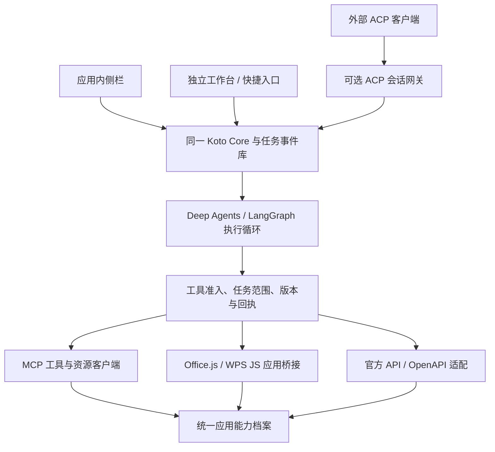

# 双入口交互与应用能力接入设计

2026-10-20。状态：设计与交互原型，尚未替换正式侧栏，也未实现跨应用协议运行时。用户已选择“应用内侧栏和独立工作台都有，同一任务在两处继续”。

## 产品结构

Koto Core 是唯一任务所有者。应用内侧栏与独立工作台均为客户端，不各自创建 Agent 和历史。快捷键只是唤起入口：有支持内嵌的当前应用时打开其侧栏，其余情况打开工作台。常用功能区保留小型 Koto 按钮；不增设占满一行的独立功能区。快捷键可配置，注册冲突时提供替代键；Windows/Mac 分别验收。

- 应用内侧栏：处理当前选区、查看宿主中的真实改动、随时反馈。默认只显示任务标题、目标、对话和输入框。资料展开为独立区域，不覆盖对话。
- 独立工作台：文件树、任务列表、对话和可展开的对象预览。跨文件和跨应用编排在这里更方便；切到侧栏沿用同一任务编号、消息、资料、草稿和检查点。
- 任务属于工作区，不再按“某文档窗口的一次网页会话”定义。一个任务可以引用多个应用资源，但每项操作都有明确目标。

## 布局与交互

### 应用内

顶部只保留 Koto、任务入口、移到工作台、收起。下面一行显示当前目标，如“季度报告.docx · 第1—2段”。标题菜单显示近期任务的自然语言标题、最后一句内容和时间；按任务恢复，而不是隐藏在按文档分散的历史搜索里。

资料为独立的可固定区域。侧栏宽度充足时可左右排；默认窄侧栏采用上下分区，资料树位于对话上方，最多占可用高度的约四分之一。展开、搜索、引用不替换对话，不清空草稿，不关闭修改检查点。文件项区分“引用资料”和“打开预览”，避免把点击文件名当作模糊的多种操作。

对话只显示用户要求、简短结果、必要的来源链接。逐段修改在宿主中显示，聊天里只留一行“第1段已更新”和可展开的前后对照。输入框紧接短对话；内容变长后再采用独立滚动与可见输入框，不预留大块固定空白。

检查点只突出“继续下一段”。反馈仍在同一个输入框中发送，直接标明“反馈会先调整第N段”。检查点期间提供低强调的“同时用于后续段落”选项，默认仅调整当前处；不再要求用户在“重做/调整/继续”等多种按钮之间猜测发送行为。文字要求与所选范围冲突时先澄清，不猜测并扩大修改范围。保留“撤回此处”作为低强调操作；无法可靠还原的宿主不显示虚假的撤回能力。

### 工作台

左侧固定资料树和近期任务，中央连续对话，右侧按需展开资源预览。文件树与对话不使用互相替代的页签。窄屏时资料区转为独立的上方区域，预览放到下方；不把两列强行挤进300像素。

当前修改目标持续可见。点击来源文件只打开来源预览，不更换正在修改的对象。切换当前应用仅改变“正在查看”的资源；若任务仍绑定原文档，显示“当前任务仍修改季度报告.docx”，提供回到目标的入口。只有新要求明确变更目标并完成绑定后，新的写入才能换目标。

### 状态与反馈

| 内核状态 | 用户看到 | 主操作 |
|---|---|---|
| ready | 选中内容，直接提要求 | 发送 |
| working | 正在读取/处理的具体对象；可继续输入 | 停止，或暂停并发送反馈 |
| review | 第N处已更新，宿主读回确认；显示短结果 | 继续下一处；输入反馈 |
| blocked | 一句话原因，以及需要补充的具体内容 | 补充信息/重新连接 |
| uncertain | 该处执行结果尚未核实，已暂停 | 核对实际对象；不重发写入 |
| complete | 已完成的文件或修改结果 | 继续提问/新任务 |

状态不是进度动画：只有宿主读回或有可验证输出回执时才显示“已修改”。用户在执行中发送反馈，Core 先停止尚未派发的操作；已开始的写入等待确认后再把反馈应用于下一安全检查点，界面明确显示“正在停止，等待当前操作确认”。

## 通用入口与协议分层

协议按职责使用：

| 层次 | 采用方式 | 额外需要实现 |
|---|---|---|
| Agent 与外部客户端 | 可选 ACP v1，会话新建/加载/提示/取消及事件更新 | 本地双入口先共用 Core API；不要为了两个自有界面强行引入 ACP 代理链 |
| 应用工具与资料 | MCP，版本适配与工具/资源发现、调用、变更订阅 | 已批准的连接配置、能力映射、资源版本、宿主效果验证 |
| 原生文档 | Office.js、WPS JS 等官方 SDK 桥接到同一工具边界 | 选区、未保存内容、局部写入、独立读回及宿主错误语义 |
| 只有 HTTP API 的应用 | 官方 API/OpenAPI 经已审核适配器进入同一边界 | 显式的读写效果和对象身份映射；不能仅凭请求方法推定副作用 |
| 没有可用协议的应用 | 显示可用的文件交接或受控自动化能力 | 单独开发并验收平台适配器，不能宣称自动可靠控制 |

MCP 提供工具与资源发现，不规定宿主UI、当前选区、逐段写入或回滚。ACP 负责客户端和 Agent 会话，不替代应用适配。A2A 仅在确有跨Agent协作需求时另行引入，第一阶段不增加依赖。

已核对 MCP 2026-07-28：该版本无协议级连接会话，应由调用中的明确句柄承载应用/对象身份；每个请求有版本及客户端能力元数据。旧版本的初始化与订阅方式交给版本适配器处理，不把旧版 initialize 流程硬编码成唯一握手。Koto 自身持久任务与网络连接生命周期独立。

## “自动适配”的准确边界

连接是用户添加或应用主动注册到本地 Core 的已批准连接。Koto 自动读取其协议版本、工具、资源和能力变化，随后生成工具面、上下文入口和可用操作。不会扫描任意端口、执行远端提供的启动命令，也不会因为工具自称“只读”就绕过准入。

两级适配：

1. 通用接入：只要MCP工具具备有效schema且通过准入，即可按原工具能力完成分析和任务；不必为每个应用重写Agent。工具名称以连接唯一ID命名空间隔离。
2. 深度编辑：已审核的能力档案将应用工具明确映射到“读取选区、读对象、局部修改、读回、还原”等语义。具备范围绑定、版本前置条件和读回验证后，才启用逐段可见的编辑体验。缺少这些能力的应用仍可读取、调用已授权工具，但不显示未经支持的选区和写入功能。

能力档案是 Koto 宿主内部配置，不是新发明一套替代MCP的网络协议。沿用已有 `app/core/agent/plugin_protocol` 的准入、权限和限额；档案仅描述应用语义。已有包的 `PluginTransport.MCP` 是声明和准入合同，不等于仓库已经实现了MCP执行客户端。当前文档不更改该包的运行行为。

## 对象、能力与事件合同

每个连接具有 Core 分配的 `connection_id`，应用实例具有 `instance_id`；任务不引用模糊的“前台窗口”。资源句柄包括连接、应用实例、不透明资源ID、版本和有效期。片段句柄另绑定父资源、范围与绑定代次。

能力至少区分：

- `context.observe`：当前对象、选区和可用状态；有事件则订阅，没有则在授权范围内有界轮询。
- `resource.read`：可读内容类型、覆盖范围、分页、未保存内容来源。
- `resource.patch`：可编辑片段、版本前置条件、每次最大粒度、是否可定位。
- `resource.verify`：独立读回或可核对版本回执；工具返回“成功”不能自动替代效果核对。
- `resource.revert`：仅当宿主支持且当前版本仍匹配时还原；否则提供只读前后对照。
- `artifact.handoff`：保存/导出后的文件交接；投递应用与收件人另行绑定，不因拖拽预览直接发送。
- `ui.embed`：宿主是否支持内嵌区、可用宽度和入口；由客户端实际检测，不由远端模型自称。

不是每个应用都必须实现全部能力。通用工具也可保留自身的记录、画布、数据库等对象模型，不强迫全部变成“文档段落”。图像、表格、幻灯片等结构按能力返回结构化视图，无法解释的格式显示原始结果及覆盖限制。

建议事件包：`task_id / seq / event_id / caused_by / source / kind / body`。Core 为每个任务分配单调seq，两个界面以游标补齐事件；重连只重放展示事件，绝不重放写入。宿主上下文事件有资源版本和绑定代次，旧事件不可覆盖当前绑定。

客户端有各自的查看位置和展开状态，任务有共同的消息、目标、资料和结果。草稿以 `(task_id, author_id)` 保存版本；从一个入口移到另一个入口时转移编辑租约。双入口同时编辑时保留冲突草稿，不能以最后写入者覆盖未发送内容。运行中任务只有一个执行者；第二个界面发送消息进入同一按序输入队列，不启动第二个Agent。

每次副作用调用携带 Core 的 `operation_id`、任务代次、目标句柄和预期版本。已验证重复操作返回回执；结果不明时停止该写入链。适配器重连不使旧句柄自动获得新对象权限。

## 跨应用示例

用户在WPS选中两段：“参考预算表更新说明，再整理一份发送稿”。Agent读取已引用Excel资源，逐段更新原WPS文档，停下接收反馈。用户在工作台继续说“后面都更简洁”，同一检查点更新方向；随后生成发送稿。查看Excel不会更换WPS目标。

需要把保存后的文件拖进微信时，由桌面文件交接桥提供原生文件拖拽，并核对保存版本。仅有浏览器页面的侧栏不能被假定具有系统文件拖拽能力。没有微信可用工具时提供原生交接入口，不伪造已发送或自行猜收件人。Windows和Mac分别实现、分别验收。

## 交付与验收顺序

| 阶段 | 实施内容 | 验收标准 |
|---|---|---|
| 交互外壳 | 自有双入口连接同一任务、独立资料区、任务历史、目标提示 | 展开资料不移除对话/草稿/检查点；两入口往返20次不丢消息、不重复任务；320/380/520/1024像素可操作 |
| 事件与状态 | Core事件游标、输入队列、草稿版本与单执行者 | 注入断线、乱序、双窗口输入后，消息顺序与执行次数正确；任务复原不触发写入 |
| 现有宿主桥接 | WPS/Word连接进入能力档案，保留逐段边界 | 同一原生文档选区正确、每改一段可见、反馈改变方向；切换应用不误写；未保存内容读回准确 |
| 通用MCP | 受批准连接的发现、schema、分页、版本分支、工具调用 | 接入两个与Office无关的MCP服务，无需修改Agent提示或关键词路由；声明变化、撤权、同名工具均正确处理 |
| 深度应用档案 | 再接Excel/PPT或另一种原生编辑应用 | 没有局部写入/读回能力时自动降为可用的操作集合；支持时独立验证局部修改，不改其它对象 |
| 跨平台交接 | 原生快捷入口与文件拖拽 | Windows、Mac各自提供真机证据；不把模拟接口或原型交互计为原生通过 |

拟定体验目标：本地输入与折叠反馈在100ms内；有宿主事件时选区标签更新目标300ms内；首个模型结果时间单独记录，不与UI响应混为一谈。这些是验收目标，尚无当前实现的测量结论。

## 已核对的上游依据

- [MCP tools](https://modelcontextprotocol.io/specification/2026-07-28/server/tools)：发现、schema、结构化结果；注解并非可信授权；显式句柄承载工具状态。
- [MCP resources](https://modelcontextprotocol.io/specification/2026-07-28/server/resources)：资源与可选变更订阅。
- [MCP versioning](https://modelcontextprotocol.io/specification/2026-07-28/basic/versioning)：按协议版本适配请求元数据与行为。
- [ACP session setup](https://agentclientprotocol.com/protocol/v1/session-setup)：加载会话需要能力声明，可用于不同客户端恢复。
- [Office task pane](https://learn.microsoft.com/en-us/javascript/api/office/office.taskpane)：宽度能力有需求集与平台限制；运行时检测支持，不承诺所有Office/WPS版本相同。

随附的能力档案schema与示例只用于评审设计，不作为已实现的注册/执行接口。

- [能力档案schema](application-capabilities.schema.json)
- [原生编辑、只读应用及通用工具的三类示例](application-capabilities.examples.json)

本次交互原型完成13项检查，覆盖资料与对话同时存在、草稿保留、两个入口往返20次、反馈范围、逐段显示、历史返回、撤回、停止、新任务单段绑定、窄窗布局，以及设计schema的正反例。记录位于 `.pytest_tmp/unified-entry-design-20261020/prototype-checks.json`。这只是本地交互原型与合同校验，没有调用模型、连接实际应用或取代WPS真机验收。
