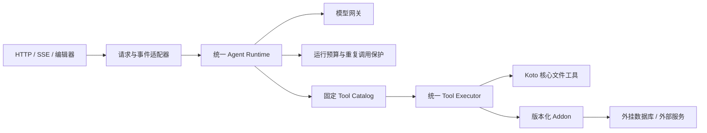

# Koto Agent Kernel 重建方案

状态：阶段 1-3 完成；文件任务生产链路已统一
内核协议版本：`1`

## 目标

Koto 只保留一套 Agent 执行语义：模型负责判断下一步，Koto 负责提供固定工具、执行工具、限制循环、核验结果并发出事件。文件格式能力、第三方系统和专用知识不进入 Agent 内核，后续通过插件和外挂数据库接入。

目标链路：

## 不可破坏的内核规则

1. 一个用户任务只进入一套模型—工具循环；界面差异只能由适配器处理。
2. 模型只能看到当前任务 allowlist 内的固定工具，不能在运行时创建或上线工具。
3. 每个工具必须有名称、描述、JSON 输入 schema、真实 handler、来源和版本。
4. 插件工具按批次原子注册；任一契约错误时整批拒绝，不允许“装上一半”。
5. 所有工具调用返回统一的 `ToolResult`：成功值或稳定错误码，以及调用 ID 和耗时。
6. 所有循环共享步数、工具调用数、总时长和重复批次预算。
7. 文件写入采用 read → write → verify；只有执行成功且核验通过才能报告完成。
8. 缺少可复用能力时产生 `tool_gap`；一次性计算优先使用受控沙盒，不把临时代码伪装成平台工具。
9. Flask、SSE、具体 LLM SDK、DOCX/XLSX/PDF/PPTX 实现不得被内核反向依赖。
10. 插件和外挂数据库不能直接发 UI 事件或修改 Agent 状态，只能通过内核结果返回。

## 阶段 1 已建立的代码边界

- `app/core/agent/kernel/contracts.py`：工具调用、结果、插件清单和运行预算。
- `app/core/agent/kernel/catalog.py`：线程安全、原子更新、可生成模型工具定义的目录。
- `app/core/agent/kernel/execution.py`：统一执行、超时和错误分类。
- `app/core/agent/kernel/guard.py`：步数、调用数、时长和重复批次保护。
- `app/core/agent/kernel/instructions.py`：模型必须遵循的固定工具使用规则。
- `app/core/agent/kernel/lifecycle.py`：统一 Agent 请求、事件、运行状态和事件构造器。
- `app/core/agent/kernel/model.py`：唯一模型网关协议、模型响应与工具调用归一化。
- `app/core/agent/kernel/runtime.py`：固定 allowlist、运行预算、模型—工具循环和统一事件。
- `app/core/agent/tool_registry.py`：旧 API 的兼容入口，内部已经接入新内核。
- `app/core/agent/tool_profiles.py`：唯一 `core` 工具 Profile、内置工具装载报告和 Addon 贡献者边界；不加载 Skill、MCP 或用户脚本。

## 当前重复链路与迁移目标

| 当前实现 | 当前用途 | 目标处理 |
|---|---|---|
| `kernel_agent.py` + `kernel/runtime.py` | 当前通用聊天生产入口与唯一 Kernel 循环 | 保持为唯一通用 Agent 生产实现 |
| `unified_agent.py` | 旧通用循环 | 已由 KernelAgent 接管并删除 |
| `task_agent.py` | 旧 Skill 嵌套任务 | 已删除；Skill 仅保留隔离的提示兼容，不提供执行能力 |
| `file_task_runtime.py` + `file_task_kernel_adapter.py` | 工作区文件任务主路径 | 已保留分类/格式策略/核验，模型—工具回合只由 `kernel/runtime.py` 驱动 |
| `doc_agent.py` | 旧文档工具循环 | 已删除；共享 `FileHandle` 已迁入文件领域 |
| WebSocket executors | 文档编辑器事件与流式适配 | 保留格式策略，但不再通过隐藏开关选择第二套 Agent |
| `workflows/*` + `workflow_engine.py` | 早期确定性办公工作流 | 无生产调用者，已整体删除；办公任务由 Kernel 调用原子读写工具完成 |
| `factory.py` | 确定性组装 KernelAgent、KernelRuntime 与显式工具 Profile | 已完成生产切换；继续收敛调用者 |
| `task_tools.py` | 基础工具包的旧兼容门面 | 只保留迁移期兼容导出；实现逐步归入 `toolkits/foundation` |

## 基础工具包边界

拆分大文件不等于把工具打散。Koto 自带的通用文件能力统一属于版本化基础工具包
`koto.foundation`，代码所有权边界为
`app/core/agent/toolkits/foundation/`。包内可以继续按格式和职责拆成小模块，Kernel
看到的来源始终是 `toolkit:koto.foundation`，并记录工具包版本。

当前已归入基础工具包的模块：

- `multi_file.py`：无模型调用的跨文件只读比较；
- `pptx.py`、`pptx_layout.py`、`pptx_theme.py`：演示文稿写入、布局与主题；
- `docx_*`、`xlsx*`、`pdf_window.py`：Word、表格和 PDF 格式实现；
- `conversion.py`、`office_create.py`：文件转换与 Office 文件创建；
- `catalog.py`、`capabilities.py`：固定工具目录、结果契约和机器可读能力成熟度。

`task_tools.py` 在迁移期继续提供旧函数和 `TaskToolsPlugin`，但不再作为新实现的
归属位置。基础工具包只放 Koto 通用内建能力；法律、商业、银行数据源等专业能力
属于独立 Addon，通过版本化工具协议进入 Kernel，不能反向导入基础工具实现或
绕过工具目录直接接管运行状态。

完整的现状能力、银行场景覆盖判断和缺口见
[`FOUNDATION_TOOLKIT_SCOPE.md`](FOUNDATION_TOOLKIT_SCOPE.md)。

## 迁移与删除顺序

### 阶段 2：统一模型和事件协议

已完成：生产 `create_agent()` 不再根据 LangGraph 是否安装改变返回类型；聊天
SSE 不再执行 LangGraph → Unified 双重回退；默认使用固定 `core` Profile。

已完成：编辑器 SSE、文档 WebSocket、Socket 入口和测试已经直接使用 Kernel
生命周期协议；旧 `app/core/agent/lifecycle.py` 兼容入口已删除。

1. 定义 `ModelGateway.generate(messages, tools)` 的唯一返回结构。（已完成，并由生产 KernelAgent 通过 ProviderModelGateway 使用）
2. 定义 `AgentEvent`，由 HTTP、SSE、WebSocket 适配器各自映射。（已完成协议与编辑器/文档入口迁移）
3. 实现一个只依赖 Kernel 的 Runtime，并复用 `RunGuard`。（已完成；通用 Agent 工厂、后台任务与目标任务已迁移）
4. 用录制响应测试无工具、单工具、多工具、失败修正、重复调用、取消和超时。（已覆盖固定工具循环、结构化结果、重复调用与错误边界；继续补齐入口级对照）

### 阶段 3：先迁文件任务

1. 文件模型调用通过 request-bound 网关接入 Kernel `ModelGateway`/`ModelResponse` 协议。（已完成）
2. 文件工具由 `FileTaskToolGateway` 发布为 Kernel `ToolCatalog`，事务与参数兼容留在文件工具边界。（已完成）
3. `FileTaskKernelAdapter` 只负责请求和事件映射；模型—工具回合、allowlist、预算、重复调用保护由 `KernelRuntime` 唯一持有。（已完成）
4. 旧 `file_task_execution_loop.py`、AI 意图裁决器、DOCX 批注专用 runner、长 DOCX 分步 runner 及其循环 guard 已删除；DOCX 批注由主循环生成内容后调用 `write_docx_comments` 原子写入。（已完成）

### 阶段 4：迁通用聊天、Addon 和编辑器

1. `handle_agent_task()` 只选择适配器和工具 profile，并由 KernelAgent 执行。（已完成）
2. Addon 通过准入协议提供工具 allowlist 和受控数据源；Legacy Skill 不进入工具面。
3. 文档编辑器只映射统一事件，不合成工具调用。

### 阶段 4.5：删除孤立确定性工作流（已完成）

`app/core/workflows/`、`workflow_engine.py` 与 `services/workflow_manager.py` 经生产引用审计确认不可达后已删除。通用文件读取迁入 `app/core/file/text_extraction.py`；不再维护第二套 Workflow Catalog、Executor Registry 或 SSE 协议。

### 阶段 5：插件与外挂数据库

插件必须提供版本化 manifest 和一批 `ToolSpec`/`RetrieverSpec`。数据库连接由插件自身管理，但查询权限、超时、结果大小、租户/ACL 边界和审计信息由执行策略约束。插件不能导入 `web.*`，核心 Runtime 也不能导入具体插件。完整的规范性条件见 [PLUGIN_INTEGRATION_PROTOCOL_V1.md](PLUGIN_INTEGRATION_PROTOCOL_V1.md)。

### 阶段 6：删除旧代码

只有满足以下门禁才删除一条旧链路：

- 对应入口已 100% 指向统一 Runtime；
- 单元、集成和 SSE/编辑器契约测试通过；
- 写任务具有真实文件核验测试；
- 至少一个发布周期没有触发旧链路回退；
- 删除后 `rg` 不存在生产引用。

`UnifiedAgent`、`TaskAgent` 嵌套 Skill 循环、旧 `DocAgent` 工具循环和文件任务第二循环均已删除。文件格式工具仍作为 Kernel 下方的领域能力保留。

已删除：无生产引用的 `deep_research.py` 孤立 Agent 及其专属测试。该删除不影响
`WebSearcher.deep_research_for_ppt`，两者是不同实现。

已删除：独立 `langgraph_agent.py` 与 `multi_agent.py` 循环及其专属工厂 API。
开发 Mermaid 接口已改用 Kernel 标准拓扑；研究、文档和 PPT 任务也必须通过 Kernel 工具面执行。

已删除：`annotate_file` 与 `extract_to_file`。前者只记录内存变更、没有真实写回文件；后者在工具内部再次调用模型并粗粒度重写 Office 文件。DOCX 原生批注使用 `write_docx_comments`，跨文件抽取由主模型读取源文件后选择目标格式的原子写入工具。

## 当前边界

- 不把 Office/PDF 的格式策略塞入 Kernel；它们继续位于文件工具和终态质量门。
- 不把外部插件默认装入全量工具集；工具必须按任务 profile 显式选择。
- 不让外挂数据库参与 Agent 状态管理；它只是插件工具的数据源。
