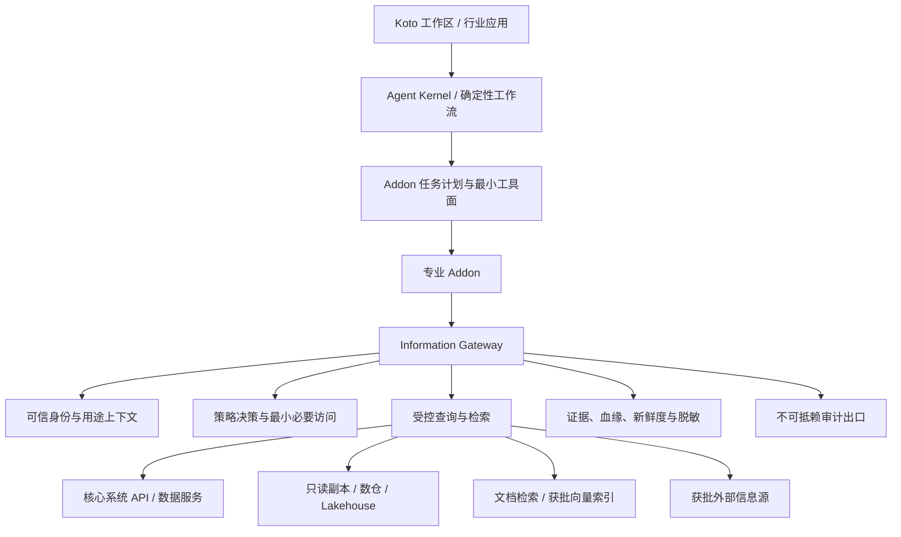
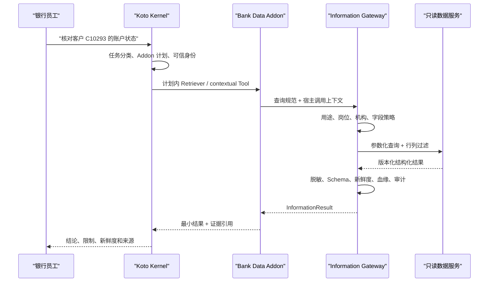

# Koto 信息管理体系设计

状态：架构设计 + Phase 0/1 可运行基础 `0.3`

适用范围：Koto 通用产品、企业知识管理、银行数据查询、合同与法律证据、未来
Live Database 和专业 Addon。

当前实现快照（2026-07-20）：

阶段测试与完成度见
[`INFORMATION_MANAGEMENT_PROGRESS_2026-07-20.md`](INFORMATION_MANAGEMENT_PROGRESS_2026-07-20.md)。

- 已建立独立的 `app/core/information/`，不依赖 Web、Agent、LLM 或具体 Addon；
- 已实现内存 Source/DataProduct/FieldPolicy 目录、查询模板、默认拒绝策略、字段脱敏、
  新鲜度、血缘、安全审计和故障闭锁；
- Mock Connector 在数据源侧执行 tenant、机构范围、参数和投影过滤；
- 已通过 `InformationRetrieverAdapter` 接入现有 Addon v1 Retriever，而没有建立第二套
  插件协议；
- 宿主可信 `AddonInvocationContext` 已通过 Kernel Runtime/ToolExecutor 带外注入
  Database Tool；模型伪造、上下文缺失和旧式无上下文 Database Tool 均默认拒绝；
- 目录持久化、真实只读连接器、企业身份映射、缓存隔离、限流/字节预算和不可变审计
  属于后续阶段，当前实现不能直接连接生产银行数据库。

## 1. 结论

Koto 不应把所有客户信息复制成一张大表、一个向量库或一个超长 Prompt。未来的
信息管理能力应建设为独立的 **Information Management Layer（信息管理层）**：

- Agent Kernel 负责理解目标、规划和受控执行；
- Addon 负责法律、银行、商业等专业能力和具体数据源适配；
- 信息管理层负责数据目录、可信身份、访问决策、查询限制、脱敏、证据、血缘、
  新鲜度和审计；
- 数据仍保留在核心系统、数据仓库、文档库、搜索引擎或获批的向量索引中；
- 模型只看到完成当前任务所必需的最小结果和证据，不接触数据库连接、任意 SQL、
  全库数据或未授权字段。

该体系不是新的 Agent、Skill 或巨型 Addon。它是 Koto 和所有数据型 Addon 之间的
宿主基础设施。

## 2. 目标与非目标

### 2.1 目标

1. 让文件、知识库、数据库、API 和事件流以统一的数据产品方式被发现和治理。
2. 保持 Koto 当前 Addon v1 的兼容性，不建立第二套工具或插件协议。
3. 为千万级客户、账户和历史记录提供分页、聚合、快照与查询下推，而不是把数据
   送入模型上下文。
4. 默认支持银行需要的租户隔离、岗位权限、用途限制、字段脱敏、证据引用和审计。
5. 读操作与写操作物理分层；早期产品只开放只读信息能力。
6. 同一信息请求可以由数据库、API、RAG 或混合来源完成，但对 Agent 返回统一结果。

### 2.2 非目标

- 不让模型生成或执行任意 SQL；
- 不把核心银行数据库改造成向量库；
- 不用信息管理层代替核心账务、CRM、KYC、AML 或文档系统；
- 不允许 Addon 绕过 Agent Kernel 自建任务循环或直接修改前端状态；
- 不在第一阶段开放自动开户、账户写入或资金交易；
- 不把现有个人工作区 KnowledgeBase/RAG 直接声明为银行级知识设施。

## 3. 总体架构



体系分为两个平面：

### 3.1 控制平面

控制平面不读取业务正文，管理：

- 信息源与数据产品目录；
- Schema、字段语义、负责人、数据等级和保留策略；
- Addon 与数据产品的绑定关系；
- 权限策略、用途代码、岗位和机构范围；
- 查询模板、限额、SLA 和新鲜度目标；
- 连接配置与密钥引用；
- 版本、发布、下线和兼容性。

### 3.2 数据平面

数据平面处理每次真实请求：

1. 接收宿主生成的可信调用上下文；
2. 判断主体是否能以当前用途访问指定数据产品和字段；
3. 将逻辑查询编译为预定义 API、参数化 SQL、搜索或 Retriever 请求；
4. 在数据源侧执行行级过滤、聚合、分页和字段裁剪；
5. 对返回值做 Schema 校验、二次脱敏和数据等级检查；
6. 生成结构化记录、证据、血缘、新鲜度及审计事件；
7. 只把当前任务必要的信息交给 Agent。

## 4. 与现有 Koto Addon 的兼容关系

信息管理层建立在现有 Addon Protocol 和 Addon Runtime 上，不修改以下边界：

| 现有能力 | 信息管理层使用方式 |
|---|---|
| `PluginManifestV1` | 声明数据权限、传输、限制、数据等级和贡献 Schema |
| `AddonBinding` | 按任务、意图、文件类型和能力选择信息贡献 |
| `database.read` | 只读数据产品、查询工具或 Retriever |
| `database.write` | 未来单独的命令型贡献，禁止与读取贡献混用 |
| `RetrieverSpec` | 当前银行只读信息接入的首选方式 |
| `RetrievalRequest` | 已携带宿主可信的 tenant、principal 和 correlation ID |
| `EvidenceChunk` | 映射来源、引用、ACL、元数据和证据正文 |
| `ToolSpec` | 适合确定性计算；银行数据工具需先增加宿主调用上下文 |
| Addon 审计 | 记录调用生命周期；信息层补充策略、字段、来源和血缘审计 |

### 4.1 当前可以直接使用的路径

当前 `RetrieverSpec` 已经由宿主注入 `tenant_id`、`principal_id` 和
`correlation_id`，并验证 ACL、引用和块数。因此第一阶段的银行数据库、合同库和
法律库应优先包装为只读 Retriever：

```text
AddonRuntime.plan()
  → AddonRuntime.retrieve(trusted identity)
  → Information Gateway
  → 权限过滤后的数据库/API/索引
  → RetrievalBatch + EvidenceChunk
  → Koto 系统上下文
```

### 4.2 必须补齐的协议缺口

普通 Addon Tool 当前只接收模型提供的参数。虽然它可以技术性地连接数据库，但模型
参数中的 `tenant_id`、`principal_id`、`purpose` 或 `correlation_id` 不能作为可信
授权依据。因此在增加下面的宿主调用上下文之前：

- 银行敏感数据库 Tool 不得投入生产；
- `database.write` 不得启用；
- 结构化只读查询优先走具有可信身份的 Retriever；
- 不允许通过 Tool 输入 Schema 要求模型自行填写身份。

建议在 Addon Protocol `1.1` 增加模型不可见、由 Kernel/Executor 带外注入的
`AddonInvocationContext`：

```text
request_id
task_id
session_id
tenant_id
principal_id
role_ids
organization_scope
purpose_code
data_classification
correlation_id
requested_at
```

兼容策略：普通无敏感数据 Tool 保持现有 handler；声明 `database.*`、
`workspace.write` 或其他高风险权限的贡献必须实现 contextual handler，否则准入
失败。调用上下文不能出现在模型工具参数中，也不能被 Addon 覆盖。

### 4.3 不改变现有 Transport 结论

当前运行时只支持可信 `in_process`。HTTP 和 MCP 仍只是 Schema 能描述的未来传输。
信息管理层第一阶段使用进程内 Gateway 接口，生产数据库连接器可以位于独立进程或
内部数据服务之后，但不能在 HTTP/MCP Transport 未实现时伪装成已受宿主管控的远程
Addon。

## 5. 核心信息模型

体系不为每个客户强制生成“1000 个字段”。它使用数据产品、实体引用、时间版本、
关系和证据组合复杂数据。

### 5.1 Information Source

描述物理信息源，不包含连接密钥明文：

```json
{
  "source_id": "core.customer-master",
  "source_type": "database",
  "owner": "customer-data-team",
  "environment": "production",
  "connection_ref": "secret:customer-master-readonly",
  "region": "cn-east",
  "read_only": true,
  "status": "active"
}
```

### 5.2 Data Product

Agent 和 Addon 只认识数据产品，不认识物理表：

```json
{
  "product_id": "bank.customer.profile.v1",
  "entity_type": "party",
  "source_id": "core.customer-master",
  "classification": "confidential",
  "owner": "customer-domain",
  "supported_operations": ["lookup", "search"],
  "query_templates": ["customer_by_id", "customer_by_name_and_org"],
  "freshness_sla_seconds": 60,
  "default_limit": 20,
  "max_limit": 100
}
```

### 5.3 Entity Reference

跨系统引用使用稳定逻辑标识，并保留来源映射：

```json
{
  "entity_type": "organization",
  "entity_id": "org:8fa1...",
  "source_refs": [
    {"source_id": "core.crm", "record_id": "C10293"},
    {"source_id": "core.kyc", "record_id": "K88411"}
  ]
}
```

模型不得负责生成实体主键、客户归并或跨系统身份映射。实体解析由主数据服务或专用
实体解析 Addon 完成，并返回置信度与依据。

### 5.4 Field Policy

字段策略与物理 Schema 分离：

```json
{
  "field": "legal_representative.document_number",
  "classification": "restricted",
  "masking": "document_id_partial",
  "allowed_purposes": ["kyc_review", "account_opening_review"],
  "allowed_roles": ["kyc_officer"],
  "exportable": false,
  "model_visible": false
}
```

同一记录可以包含不同等级字段。记录级分类不能代替字段级策略。

### 5.5 Query Specification

模型只能选择数据产品和受限条件，不能提交 SQL：

```json
{
  "product_id": "bank.customer.profile.v1",
  "operation": "lookup",
  "template_id": "customer_by_id",
  "parameters": {"customer_id": "C10293"},
  "projection": ["display_name", "status", "risk_level"],
  "as_of": "2026-07-20T00:00:00+08:00",
  "limit": 1,
  "consistency": "bounded_staleness"
}
```

`template_id` 对应宿主审核过的参数化查询、存储过程或内部 API。字段投影必须与策略
允许范围取交集。大范围查询必须转为聚合、异步导出或确定性批处理任务。

### 5.6 Trusted Subject Context

以下信息只能由宿主认证和工作流生成：

```json
{
  "tenant_id": "bank-a",
  "principal_id": "employee-7",
  "roles": ["relationship_manager"],
  "organization_scope": ["branch-3101"],
  "purpose_code": "customer_service",
  "clearance": "confidential",
  "task_id": "task-...",
  "request_id": "req-..."
}
```

用户输入可以表达业务目的，但不能自行授予 purpose、role、tenant 或 clearance。

### 5.7 Information Result

统一结果不暴露数据库对象：

```json
{
  "status": "success",
  "product_id": "bank.customer.profile.v1",
  "records": [
    {
      "record_ref": "core.customer-master:C10293@42",
      "data": {
        "display_name": "示例企业",
        "status": "active",
        "risk_level": "medium"
      },
      "classification": "confidential",
      "redacted_fields": ["legal_representative.document_number"]
    }
  ],
  "evidence": [],
  "freshness": {
    "observed_at": "2026-07-20T09:30:00+08:00",
    "source_version": "42",
    "stale": false
  },
  "policy": {
    "decision_id": "pd-...",
    "decision": "allow_with_redaction"
  },
  "lineage_id": "lin-...",
  "next_page_token": null
}
```

对模型默认返回摘要和必要字段。完整记录只能在经过授权的结构化 UI 中显示，不应
自动拼入 Prompt。

### 5.8 Evidence and Lineage

每个可用于结论的信息片段必须能回答：

- 来自哪个数据产品、数据源和记录版本；
- 何时查询或观察；
- 使用了哪个查询模板及参数摘要；
- 经历了哪些脱敏、聚合和转换；
- 哪个策略决策允许了访问；
- 哪个 Addon、版本和 manifest 摘要执行了调用；
- 在哪个任务和回答中被引用。

文档/RAG 证据映射到现有 `EvidenceChunk`。结构化数据库结果使用 `record_ref`、
`source_version` 和 `lineage_id`，必要时生成可展示的 citation，例如“客户主数据，
记录 C10293，版本 42，截至 2026-07-20 09:30”。

## 6. 银行业务领域结构

银行信息不应按“每个账户 1000 条信息”组织给模型，而应拆成领域数据产品：

| 领域 | 核心实体/数据产品 | 典型特征 |
|---|---|---|
| Party/Customer | 个人、组织、角色、关系、受益所有人 | 主数据、缓慢变化维度 |
| Account | 账户、状态、币种、权限、余额摘要 | 强时点、强权限 |
| Transaction | 流水、渠道、对手方、事件 | 高容量、时间序列，只查询窗口或聚合 |
| Product | 产品、定价、适用条件 | 版本化规则 |
| Contract | 合同、条款、附件、签署方、版本 | 文档与结构化字段混合 |
| KYC/AML | 尽调、名单命中、风险因子、复核 | 高敏、强用途限制 |
| Risk | 评分、模型版本、规则命中、解释 | 必须保留模型/规则版本 |
| Case | 工单、调查、证据、处置 | 状态机和人工协作 |
| Policy/Legal | 制度、法规、案例、有效期 | RAG、引用、时效性 |
| Audit | 操作、审批、查询、结果摘要 | 追加写、不可变更 |

实体之间使用引用和关系图连接。交易、操作日志等高容量事实不嵌入客户主记录，只在
任务需要时按时间窗、聚合或分页查询。

## 7. Live Database 接入模式

### 7.1 优先级

1. 内部受控数据 API；
2. 只读副本或专用查询库；
3. 数仓/Lakehouse 数据产品；
4. 核心生产数据库只读连接，仅在无替代方案且通过专项评审时使用。

### 7.2 强制规则

- 独立只读账号、连接池、网络白名单和密钥管理；
- 参数化查询或批准的存储过程；
- 禁止任意 SQL、Schema 枚举和跨产品 JOIN；
- 超时、最大扫描行数、最大返回行数和成本预算；
- 查询条件下推到数据源，禁止先全量拉取再在 Python 中过滤；
- 行级权限在数据源或 Gateway 过滤，不能交给模型过滤；
- 返回后再次做字段级授权和脱敏；
- 快照时间、一致性级别和数据新鲜度必须进入结果；
- 故障时明确返回 unavailable/stale，不得让模型猜测；
- 禁止连接、游标、ORM 对象、内部表名和执行计划进入 Agent。

### 7.3 千万账户规模

规模由数据库和数据平台处理，模型不参与全量扫描：

```text
10,000,000 客户 / 账户
  → 索引、分区、数据产品和实体服务定位
  → 数据源侧过滤 / 聚合 / 时间窗口
  → 返回 1–100 条结构化结果或统计摘要
  → 仅选定字段进入 Agent
```

批量分析应转为异步任务，产出统计表、异常清单或证据文件，再由 Agent 解读；不能
对千万账户逐条调用大模型。

## 8. 知识库与 RAG 分层

### 8.1 现有本地知识库

当前 `KnowledgeBase`、`RAGService` 和 `GraphRAGService` 适合个人工作区、演示和
非敏感资料。它们没有形成银行所需的完整租户、主体、字段权限、用途、ACL、数据
分级和血缘契约，因此：

- 保留为 Workspace Knowledge，不作为银行主数据或受限知识入口；
- 不允许直接索引核心客户、账户、KYC 或交易正文；
- 未来通过 Information Gateway 获取已授权、已脱敏的索引输入；
- 银行知识库优先实现为 Addon Retriever，使用现有证据和身份协议。

### 8.2 权限感知索引

银行 RAG 索引必须：

- 按租户、机构或安全域分区；
- 每个 Chunk 带来源、有效期、ACL、分类和版本；
- 检索前完成 ACL 过滤；
- 删除或权限变更能传播到索引；
- 通过 CDC/事件或受控批次保持新鲜度；
- 禁止把密钥、身份证件、完整账户流水等默认送入 Embedding 服务；
- 外部 Embedding 必须经过数据外发政策审批。

## 9. 查询、检索和写入三种操作面

### 9.1 Retrieval

面向制度、合同、法律、案例和非精确搜索，返回引用证据。第一阶段直接兼容现有
`RetrieverSpec`。

### 9.2 Structured Query

面向客户状态、账户摘要、风险等级等精确数据。使用数据产品和查询模板，在
`AddonInvocationContext` 完成前可以通过 Retriever 包装结构化结果；完成后再提供
身份感知的 contextual Tool。

### 9.3 Command/Mutation

任何写入必须使用独立命令契约：

```json
{
  "command_id": "cmd-...",
  "product_id": "bank.customer.profile.v1",
  "operation": "update_contact",
  "target_ref": "core.customer-master:C10293@42",
  "changes": {"contact_phone": "..."},
  "idempotency_key": "...",
  "expected_version": "42",
  "approval_ref": "approval-...",
  "reason_code": "customer_verified_change"
}
```

写入要求确定性工作流、审批、幂等、乐观锁/事务、回读核验和补偿。Agent 可以准备
建议，但不得自行产生有效 approval、purpose 或 expected_version。

## 10. 典型流程

### 10.1 银行员工查询客户与账户



### 10.2 合同与历史法律数据比较

1. Foundation Toolkit 读取当前合同并保留页码、段落和表格位置；
2. Legal Addon Retriever 根据条款、司法辖区和有效日期检索历史合同、法规和案例；
3. Information Gateway 校验员工权限、合同安全域和检索用途；
4. Retriever 返回带引用、有效期、ACL 和版本的 EvidenceChunk；
5. Agent 只做条款对照和风险解释，不把检索内容当系统指令；
6. 文件工作流将结论写成批注或报告，并保留证据引用和任务审计。

### 10.3 未来对公开户

信息管理层只提供材料和事实，不负责最终准入决策。开户应由确定性工作流组织：

```text
OCR/材料结构化
  → 主体与企业关系解析
  → 工商、名单、KYC/AML 信息查询
  → 规则与风险判断
  → 异常/冲突证据
  → 人工复核与双人审批
  → 核心开户命令
  → 回读核验与完整审计
```

## 11. 产品界面边界

未来应新增“信息管理中心”，但不得与 Addon 中心合并：

### Addon 中心管理

- 可执行扩展、版本、权限和运行状态；
- 工具/Retriever 贡献；
- 健康、准入、启用、停用和调用审计。

### 信息管理中心管理

- 信息源和数据产品目录；
- Schema、字段定义、负责人和数据等级；
- 权限策略、用途代码和脱敏规则；
- 查询模板、索引、数据新鲜度和血缘；
- 访问记录、拒绝原因、数据质量和 SLA。

一个 Addon 可以绑定多个数据产品，一个数据产品也可以被多个经过授权的 Addon
使用。绑定关系必须由宿主控制，不能由 Addon 自行发现全部数据源。

## 12. 建议代码边界

第一阶段建议新增独立包，不放进 `agent`、`addons` 或 `services` 巨型模块：

```text
app/core/information/
  contracts.py          # Query、Result、Context、Evidence、Lineage
  catalog.py            # Source/DataProduct/Schema 目录
  policy.py             # 策略接口与决策结果
  gateway.py            # 唯一查询执行入口
  query_templates.py    # 参数化查询模板注册表
  masking.py            # 字段脱敏与最小必要投影
  evidence.py           # EvidenceChunk/结构化证据映射
  lineage.py            # 来源、版本、转换与引用链
  audit.py              # 信息访问审计出口
  freshness.py          # 快照和新鲜度判断
  mutations.py          # 后期写入命令、审批与幂等
  connectors/           # 仅宿主批准的数据库/API 适配接口
```

建议依赖方向：

```text
Agent/Addons → information contracts + gateway
information gateway → catalog/policy/connectors/audit
connectors → 具体数据库/API SDK

information 不导入 web、Flask、具体 Agent、LLM Provider 或业务 Addon
```

Web 层未来只提供目录和管理 API，不包含查询权限逻辑。专业 Addon 只调用 Gateway，
不能直接访问全局 ServiceRegistry 或绕过策略连接数据库。

## 13. 分阶段实施

### Phase 0：协议安全加固

- [x] 定义 `AddonInvocationContext`；
- [x] Kernel/Executor 带外注入可信身份；
- [x] 数据库 Tool 未声明上下文时准入失败，执行时缺少上下文则策略拒绝；
- [x] 信息查询审计不记录参数值、敏感正文和连接错误；
- [x] 确认 Information contracts 不改变 Addon v1 的现有 Retriever。

### Phase 1：只读信息层 MVP

- [x] Source/DataProduct/FieldPolicy 原子内存目录；JSON 持久化待实现；
- [x] InformationQuery/Result/Freshness/Lineage 契约；
- [x] Policy Decision Point 接口和默认拒绝策略；
- [x] 参数化查询模板注册表；
- [x] 带租户和机构行范围的 Mock Database Connector；
- [x] 与 Addon Retriever 的请求和结果映射；
- [x] 租户、字段脱敏、新鲜度、审计、故障闭锁和架构依赖测试。

### Phase 2：第一个真实只读数据产品

- 选择低风险、非账务写入场景，例如产品制度、合同元数据或脱敏企业主数据；
- 对接企业 SSO/OIDC、岗位和机构范围；
- 接入企业 Secret Manager/KMS、mTLS 和网络白名单；
- 使用只读副本/内部 API；
- 完成并发、超时、数据泄漏、故障和恢复测试。

### Phase 3：权限感知知识与法律证据

- 文档摄取、版本、有效期、删除传播；
- ACL 预过滤和租户/安全域隔离索引；
- 合同、法规和案例 EvidenceChunk；
- 引用、证据 UI 和回答血缘。

### Phase 4：确定性业务工作流

- KYC/AML、合同审查和对公开户流程；
- 人工任务、双人复核、审批和 SLA；
- 写入命令、幂等、事务、补偿和回读核验；
- Agent 只提供理解、解释和协调，不拥有最终授权。

### Phase 5：平台化

- HTTP/MCP Transport 的真实宿主适配器；
- 数据产品与 Addon 发布、版本兼容和迁移；
- 多区域、容灾、限流、成本和容量治理；
- 合规报表、SIEM 和不可变审计存储。

## 14. MVP 验收条件

Phase 1 只有满足以下测试才能称为可用：

1. 没有宿主身份时所有受控查询失败；
2. 客户端或模型伪造 tenant/principal/purpose 无效；
3. 未匹配、未准入或未授权 Addon 看不到数据产品；
4. 数据产品、操作、查询模板和字段必须显式允许；
5. 行级过滤在数据进入模型前完成；
6. restricted 字段按岗位、机构和用途拒绝或脱敏；
7. 查询超时、结果行数、扫描成本和返回字节受限；
8. 结果携带来源版本、新鲜度、策略决策和 lineage；
9. 日志不包含密钥、完整证件号、完整账户号或证据正文；
10. 数据源不可用时返回稳定错误，不生成猜测答案；
11. Addon 停用或目录 revision 变化后能力即时撤销；
12. 租户 A 的缓存、索引、结果和审计不能被租户 B 访问；
13. 所有写入能力默认关闭；
14. Mock Connector、Addon、Kernel 和 Web 编排闭环测试通过。

## 15. 当前代码能力判断

| 组件 | 可复用 | 需要补充 |
|---|---|---|
| Agent Kernel | 工具循环、预算、错误、验证和事件；可信上下文已带外注入 Executor | 细化岗位/机构身份解析与跨服务传播 |
| Addon Protocol v1 | Manifest、权限、数据政策、Schema、限制及 Database Tool 上下文准入 | 数据产品 revision 撤销 |
| Addon Runtime | 准入、路由、选择、停用、Retriever 身份 | 持久化数据产品绑定和策略摘要 |
| Retriever/Evidence | 已适配租户、主体、ACL、引用、来源版本和 lineage | 用途/字段标准及缓存隔离 |
| Information Gateway | 目录、模板、默认拒绝、脱敏、血缘、新鲜度和安全审计 | 持久化目录、真实连接器、限流和不可变审计 |
| Addon Audit | 持久化生命周期事件 | 与信息访问审计汇聚到合规出口 |
| Workspace Knowledge/RAG | 个人文件索引和混合检索 | 银行多租户、ACL、分类、删除和血缘；不可直接复用为银行层 |
| Foundation Toolkit | 文件读取、比较、写入和核验 | 只消费信息结果，不拥有业务数据权限 |

## 16. 推荐的下一步

Phase 0/1 的内存基础与 Mock 闭环已经建立。下一步仍不应直接连接生产数据库，而应：

1. 为目录、查询模板和 Addon/DataProduct 绑定增加原子持久化与 revision 撤销；
2. 增加结果字节、执行时间、扫描成本、分页令牌和并发预算；
3. 选择低风险数据产品，实现第一个参数化、只读、短凭证连接器；
4. 对接真实 SSO 岗位/机构范围、Secret Manager 和不可变合规审计；
5. 完成缓存隔离、超时、并发、数据泄漏、撤销和恢复测试后再进入试点。

法律、商业、客户主数据、合同和风险 Addon 应共享这套宿主信息治理基础，而不是
各自实现权限、数据库、RAG 和审计逻辑。
