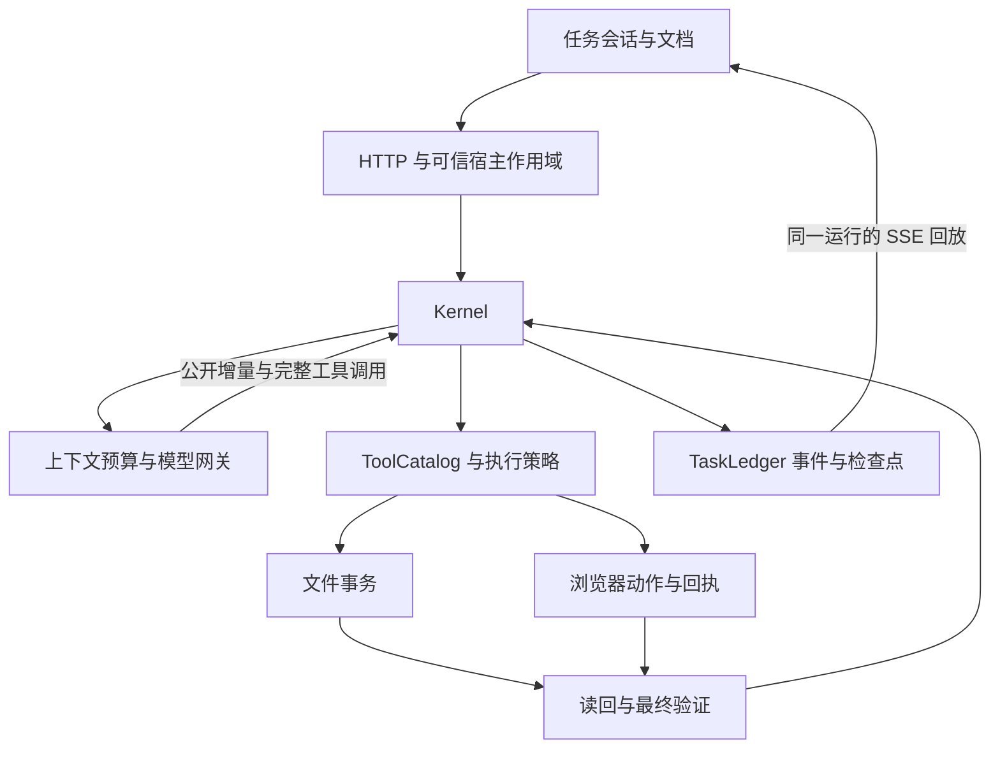

# Koto 原版 Agent 全面优化设计与实施约束

日期：2026-11-15。工程：`C:\Users\12524\Desktop\Koto`。

本轮目标是完成现有原版工作台的可靠性、编辑能力与使用体验优化，并交付重新验证的 Windows 测试包。沿用一个 Kernel、ToolCatalog 和 TaskLedger；Office/WPS 继续通过宿主适配器共享能力。已有未提交修改保持原状，不另建产品工程或并行任务底座。

## 1 用户流程与产品状态

| 场景 | 界面与行为 | 成功依据 |
| --- | --- | --- |
| 无文件启动 | 直接看到唯一输入框、最近任务和材料入口 | 无需先打开文档或寻找助手开关即可发起任务 |
| 带材料问答 | 本轮材料和选区明确；会话展示公开生成内容与真实操作摘要 | 模型实际收到对应上下文，来源能定位 |
| 修改文档 | 文档与同一会话并排；候选修改与已经应用的修改使用不同操作 | 精确目标、版本及实际应用结果一致 |
| 保存与另存 | 保留原稿、编辑稿、源文件与副本的独立状态 | 目标文件发布后读回核验，不用提示文字代替事实 |
| 中断与恢复 | 显示继续查看、停止中、等待核实等实际状态 | 恢复原 task/run/seq；继续观看不重新执行任务 |
| 生成成果 | 会话内直接打开/下载主要成果，保留完整成果面板 | 文件确实存在、内容和格式通过对应验证 |

明确请求直接修改或保存时按授权执行并展示回执；审阅模式保留逐条采纳。已经应用的内容提供受版本保护的撤销，不再显示会重复应用的采纳按钮。

## 2 唯一运行链

模型负责理解、规划和工具选择；程序负责作用域、参数、事务、恢复、验证与呈现。公开文本可以实时显示；工具参数必须完整后执行。`message.finished` 仅结束本轮消息，任务终态由验证和唯一 `run.finished` 决定。不得恢复关键词分类或另建自由文本分流层。

## 3 状态与真实性

| 对象 | 状态 | 关键约束 |
| --- | --- | --- |
| 任务 | 运行、停止中、等待核实、成功、失败、已取消 | 断线独立于失败；已提交副作用保留真实记录 |
| 修改 | 候选、应用中、已应用、失败、未知、已撤销 | 没有编辑器、抛异常、未匹配、拒绝或未知均不能变成 accepted |
| 文件 | 未修改、已编辑未保存、保存中、已保存核验、冲突 | 服务器源文件锁/备份/原子替换；浏览器句柄写前检查与写后读回 |
| 浏览器动作 | 排队、已投递、已完成、失败、未知 | 投递不等于执行完成；未知写阻止同文档新写；不能靠更换操作 ID 绕过 |

兼容提案入口与新语义工具必须服从同一应用结果标准。批量采纳只统计实际成功项，部分失败可继续核实，不将失败项安排自动保存。回执保留原因、版本、锚点及完整内容；界面可以折叠，但不能静默截断唯一记录。

## 4 文档编辑能力

复用现有 ProseMirror/Tiptap 事务和格式工具。文本与 DOCX 在精确锚点基础上扩展可靠的多段落、列表与表格单元格操作。每个操作验证完整目标、当前版本、歧义、结构边界，事务内一次发布；不通过全文替换绕过复杂结构。

目标以外的文本、列表结构、段落和字符格式必须保持。复杂或歧义操作无法可靠表达时明确拒绝，原文不变。XLSX/PPTX/PDF 已有格式能力继续保留，按相同结果与验证契约呈现，不将任意格式的细粒度编辑冒充为已覆盖。

撤销必须匹配操作后的版本及目标，防止覆盖后续人工编辑。批量和跨段落操作同样不能通过部分修改后报全成功。

Word 列表读取解析段落直接属性及样式继承链的有效编号属性，明确取消编号时不继承；不从样式名字猜测列表。源覆盖另核对实际使用的编号层级、起始、格式及重启范围，忽略无语义的编号 ID 重排。编号信息丢失时拒绝覆盖并保留源文件，不声称 HTML 导出器支持所有高级编号。

## 5 浏览器动作的持久性与安全

动作记录和回执由 TaskLedger 同库事务管理，不另建任务队列生命周期。记录可信请求、会话、浏览器、文档身份及操作命名空间；模型提供的参数不能替代服务端绑定。

动作完成回执需要匹配实际投递身份。错误浏览器、会话、投递凭据、过期动作与伪造回执必须被拒绝。浏览器本地保存执行前标记和已经完成的实际回执，刷新后可以重新提交回执；标记本身不能证明执行成功。

重启后：未投递的动作可以在有效授权内继续；已投递结果不明的写入进入核实；已完成动作返回原回执；同一请求操作不能重复执行。无法核实的动作保持未知，不承诺任意 DOM 副作用的透明 exactly-once 恢复。

## 6 前端结构与性能

保留一个输入框、任务侧栏及按需文档区。材料抽屉聚焦本任务材料与全部文件，保留历史路径和兼容操作。首屏、文档、审阅与成果状态使用一致导航和上下文，不用相互竞争的输入入口。

连接中断提供继续查看原任务；失败展示真实原因及已完成操作；冲突提供保留稿、合并或另存。用户向上阅读时暂停自动跟随，提供新内容提示。工具名称转换为可读动作，完整执行细节仍可展开。

重型审阅、差异和材料操作按需加载，编辑器与聊天增量渲染隔离。保留现有主 bundle 520 KiB 及文件所有权预算，通过合理分模块和懒加载实现，不以抬高门槛换取通过。

## 7 可测量性与任务评估

模型调用记录每轮耗时、首个公开文本增量时延、所用模型及供应商实际返回的 token。预算估算与计费 usage 分开，缺失 usage 保持未测量；指标不得包含提示词、用户材料或密钥。工具耗时与保存回执沿用现有事实。

建立 24 个固定办公任务，覆盖阅读与数字来源、修改范围与格式、生成追改及失败恢复，每项重复三次。通过独立读取最终文件和目标外内容判分。脚本模型验证工程流程，真实模型质量另列；两者成功率不得混称。

真实模型使用现有配置、调用与 token 硬预算；先做一次有限时探针，环境拒绝时记录受阻而非用假模型替代。浏览器策略或套接字限制不绕过。保留真实浏览器、真实模型及发行验收的独立结果。

## 8 实施所有权与交付门禁

| 工作包 | 主要所有权 | 交付证据 |
| --- | --- | --- |
| 提案与审阅 | results、document receipt、新审阅 helper | 异步失败/缺失编辑器/去重/批量/撤销行为测试 |
| 首屏与导航 | workspace layout、templates、shell CSS、成果呈现 | 冷启动、恢复、compact、键盘及成果操作测试 |
| 流与阅读恢复 | direct chat、message stream、已有 transport/recovery | 多次断线只 GET、原 turn 更新、取消及滚动保护 |
| 动作持久化 | observer、MCP 动作路由、TaskLedger 同库 action store | 五个崩溃断点、伪造/跨 scope 拒绝、真实 SQLite 重开 |
| 语义编辑 | document UI plugin、document actions | 多段落/表格/列表/混合格式及保存重开验证 |
| 评估与交付 | 固定任务集、验收脚本、原生构建与打包 | 72 次工程任务；实际 native 检查；包隐私及资产一致性 |
| 统一集成 | 模型指标、架构文档、覆盖核对与最终报告 | 有意义的专项和全量回归，无遗漏或重复计数 |

所有生产源文件和前端资源统一冻结后才构建新原生覆盖层。Cython 保持 Python 注解语义、负索引语义，来源清单在编译前后保持一致。新包验证原生模块、前端字节、配置隐私、ZIP 完整性及隔离可执行程序启动；旧包与用户配置保持不变。

完成记录和测得结果由最终报告承接；本设计不将目标或计划门槛当作已经通过的成绩。

## 9 Transformer 与前端即时反馈的边界

前端直接展示公开文本增量在结构上成立：模型按上下文逐步生成 token，后端将可公开的文本增量转换为事件，前端追加展示。屏幕上已经显示的文本不会自动改变模型权重，也不意味着模型可以撤回已经生成的 token。

编辑器的修改、工具执行结果、用户停止或补充要求，必须经过可信作用域和回执后成为后续模型轮次的上下文。当前未完成的工具参数不能交给编辑器边生成边执行。需要修正已显示内容时，用明确的消息更新或新的文档事务表达，保留版本、原始事件与实际副作用。

因此，实时显示、执行授权、编辑器事务和保存确认是四个不同阶段。Koto 的白盒体验来自可观察的公开输出、真实工具动作、稿件变化与文件回执，不依赖展示模型隐藏思维。界面处理增量和断线恢复，Kernel 处理下一轮判断，文件层处理提交；这种分工不要求改造 Transformer。

## 10 实现落点与交接

| 契约 | 当前主要实现 |
| --- | --- |
| 单一模型与工具循环 | `app/core/agent/kernel/runtime.py`、`execution.py`、`validation.py` |
| 可控上下文与真实调用指标 | `app/core/agent/kernel/context_budget.py`、`model_metrics.py` |
| 持久运行、事件及动作 | `app/core/tasks/task_ledger.py`、`task_journal.py`、`frontend_action_store.py` |
| 读取、失败写入及产物验证 | `app/core/agent/file_task_read_evidence.py`、`file_task_mutation_evidence.py`、`file_task_kernel_validation.py` |
| 主机观测文档结构增量 | `app/core/agent/file_task_document_metrics.py` 与现有工具事务入口 |
| Word 列表继承及源编号保护 | `app/core/file/parsers/docx_numbering.py`、`app/core/file_assistant/docx_preservation.py` |
| 编辑器语义修改与可信动作 | `web/src/mcp/document-semantic-patch.ts`、`frontend-observer-document-actions.ts` |
| 重载去重与回执补交 | `web/src/mcp/frontend-action-journal.ts`、`frontend-observer.ts` |
| 用户可见的修改回执 | `web/src/workspace/task-document-receipt.ts` 与既有提案呈现入口 |
| 被动内容渲染 | `web/src/workspace/markdown-rendering.ts` |

源文件直接修改和浏览器编辑器修改都要在最终核实后完成任务，但恢复机制不同：服务端使用原事务快照与回滚；浏览器执行结果不明时禁止盲目重放，等待原回执或人工核实。原生 DOCX 工具检测到受保护结构损失后恢复原文件；编辑器源覆盖被拒绝时保留编辑稿。不能把其中一种恢复能力套用到所有路径。

后续验收优先级是：在允许普通网络和浏览器的运行环境下，以同一组固定任务补齐真实供应商表现和浏览器操作；再根据实际失败、耗时与费用排序优化。任意复杂 DOCX 的 OOXML 保真、跨重载编辑器撤销、正式签名发行属于单独能力门槛，不以现有离线检查通过推断完成。
