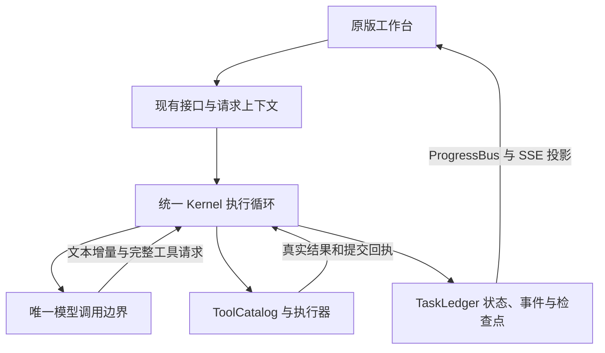

# Koto 原版工作台完整设计与实施计划

日期：2026-11-15  
范围：当前仓库保留的原版独立工作台与共用 Agent 后端。  
交付目标：用户用一个任务会话完成提问、读材料、修改文档、生成文件和继续加工，能够看到真实执行过程，区分草稿、编辑器变化与已保存成果。

实施沿用现有 Kernel、TaskLedger、ToolCatalog、模型网关和编辑器。模型负责理解目标、决定步骤和选择工具；程序负责上下文、工具执行、事务、状态、验证和界面呈现。Transformer 网络结构无需改变。

本计划定义原版的设计、实施范围与验收门槛。源码实现和前端构建已经按该范围推进；实际完成情况与环境限制见 `docs/KOTO_STANDALONE_IMPLEMENTATION_REPORT_2026-11-15.md`，不得将计划门槛本身当作已通过的验收。

## 1 产品结构

| 区域 | 用户看到的内容 | 行为要求 | 复用位置 |
| --- | --- | --- | --- |
| 左侧任务列表 | 新任务、历史、搜索和成果入口 | 一个任务保存对话、相关文件、执行记录和成果；恢复任务时能找到原来的目标 | `web/templates/_workspace_sidebar.html`、`web/src/workspace/conversation-list*` |
| 中间任务会话 | 请求、逐步生成的回答、执行摘要、成果卡 | 普通提问和工具执行使用同一输入方式；过程详情可展开 | `conversation.ts`、`task-runner.ts`、现有任务事件处理器 |
| 文档与成果区 | 当前文件、差异、引用、生成成果 | 有文档时按需展开；直接使用现有编辑器；编辑和保存状态清楚可见 | `web/src/editors/`、`docx-review-*`、`file-open.ts` |
| 文件抽屉 | 附件、最近文件、目录和当前任务相关材料 | 打开或附加文件后保留同一会话；清楚显示本轮实际使用哪些材料 | `fs-tree*`、`task-workspace-context.ts` |
| 单输入框 | 指令、附件、当前选区和目标文件 | 用户表达目标即可；不要求选择 Chat、Agent 或内部任务分类 | `primary-composer.ts`、`task-dispatcher.ts` |
| 设置与能力面板 | 模型、本地模式、知识库、技能与连接 | 作为长期配置，日常任务无需反复进入 | 现有 settings、capability、RAG 面板 |

用户可见的进度来自模型输出、工具事件和实际回执。界面使用“读取文件”“正在修改”“保存失败”等可验证表述；不将预设动画或内部事件名展示为模型的真实思考。

## 2 三条必须打通的完整流程

### 2.1 提问与材料分析

用户附加材料，输入“比较三家公司的技术路线”。运行时记录材料身份与版本，模型按需读取和检索，界面显示实际读取来源，回答逐步呈现。追问“改成表格”继续引用本次材料和结果。

验收：模型确实收到相关上下文；没有读取的材料不标记为已读；引用可以追溯；文本没有重复拼接；后续指令使用正确的成果目标。

### 2.2 文档白盒修改

用户打开文档、选中段落，输入“把这段改得更直白”。请求捕获文档、选区和版本；模型生成完整编辑操作；程序检查版本和定位条件，执行修改，返回实际前后文本；界面展示差异和撤销入口；保存后将实际持久化结果交回模型。

用户已明确要求的可逆修改可直接执行。仅在目标不清、发生冲突或现有权限契约要求处理时等待用户决定，不逐步增加无必要的确认。

验收：只修改目标范围；生成期间的人工修改不会被静默覆盖；修改失败不显示成功；保存失败保留编辑内容并明确尚未落盘；撤销以当前版本为条件，避免覆盖后续编辑。

### 2.3 读材料并交付文件

用户选择多份材料，输入“形成一份带比较表的报告”。模型读取材料、形成内容，调用已有生成或编辑工具；程序验证产物可打开、必要内容存在且写入成功，随后展示成果卡并打开预览。用户继续要求调整，沿用同一成果身份。

验收：文件真实存在并可打开；来源与正文对应；失败时保留可恢复草稿；“生成完成”依据产物回执，不能只依据模型文本。

## 3 目标运行架构

### 3.1 保留单一所有者

- Kernel 拥有模型与工具循环，文件任务通过既有适配层进入相同内核。
- ToolSpec 和 ToolCatalog 拥有工具元数据；界面和 MCP 读取投影。将必要前端操作注册为受限的内置工具，不把外部 MCP 工具整体注入默认工具面。
- TaskLedger 拥有任务、取消、终态、事件持久化与恢复信息；JobRunner 认领后台及恢复执行。
- ProgressBus 继续负责实时分发，不能作为恢复记录的唯一来源。
- ServiceRegistry 和现有装配入口管理生命周期；不在 getter 内启动线程或创建第二套全局服务。
- 现有 LLMRuntimeGateway、ProviderModelGateway 和文件任务模型适配收敛到唯一生成边界；不新增一条平行的模型调用路径。
- 现有接口可以保留兼容形状，由适配器投影统一运行事件；不恢复关键词分流器、旧 shim 或已移除的 registry。

### 3.2 请求上下文

在现有请求对象上扩充结构化上下文，至少关联：会话、任务、本次运行、用户原指令、模型选择、文件身份与版本、选区、附件、检索证据及来源、历史和记忆预算。

当前 `orchestrator.py` 准备的文件上下文、RAG 和 CWM 调入记忆须实际传入默认 AGENT 路径；避免重复拼接 Kernel 基础系统指令。文件正文与检索材料作为带来源的数据处理，不能获得系统指令权限。

上下文预算按实际模型容量计算，预留输出空间，计入工具定义、系统指令、历史和工具结果。每轮调用前检查预算；摘要必须保留当前目标、尚未完成的工具调用及对应结果。完整大结果保留在成果或工具记录中，模型按需读取。

### 3.3 模型输出与工具执行

复用 `kernel/lifecycle.py` 已有的 STREAM_CHUNK、工具和生命周期事件。模型输出增量逐层透传；工具名和参数按 call_id 聚合，完整校验后执行。不能仅把 `stream=False` 改为 `True` 后仍按完整响应解析。

供应商适配明确区分增量和累计全文。公开给上层的文本追加流统一使用增量；最终全文或修订稿使用明确的替换语义。模型切换、重试、校验修正都关联独立 attempt/message 标识，避免两段不同回答被无提示拼接。

非流式模型可返回完整文本块，并清楚表达能力边界。选择本地模型时检查实际工具调用和上下文能力，不能默认所有模型具备相同能力。

## 4 事件、编辑与恢复契约

### 4.1 同一运行事件

以下是统一展示语义；优先映射现有事件名称，新增字段在原契约中版本化，不建立第二个事件系统。

| 展示语义 | 必要关联或证据 | 规则 |
| --- | --- | --- |
| 运行开始与阶段 | session_id、task_id、run_id、状态 | 阶段描述必须对应实际运行 |
| 文本增量 | message_id、attempt_id、delta、通道 | 同一消息按增量追加；草稿与已验证回答可区分 |
| 工具开始、进度、结果 | tool_call_id、step_id、工具名 | 调用、进度、结果始终可关联；进度在工具结束前送达 |
| 修改提案与编辑器变化 | action_id、document_id、expected_revision、实际新版本 | 排队成功不代表编辑完成 |
| 文件提交与验证 | 目标、提交标识、文件版本或摘要、验证结果 | file.changed 与保存成功只基于真实提交 |
| 等待、取消、失败、完成 | 明确原因、剩余未提交成果、终态 | 遵守 first-terminal-wins，晚到事件不改写终态 |

所有持久运行事件带 `run_id + seq`，序号由同一持久化边界分配一次。实时流、回放和 UI 投影复用同一个序号；界面装饰与传输心跳不创建额外业务序号。前端对重复事件去重，发现缺口后请求补齐。当前文件流先持久化、后重新编号的顺序须收敛为“标准化、分配序号、持久化、发布”。

文本增量可在短窗口内合并后持久化与发送，避免逐 token 同步写盘。事件持久化应先于可恢复流发布；刷新页面后可从持久消息快照与后续增量重建一致的回答。

### 4.2 前端动作回执

复用 `frontend-observer.ts` 和 `frontend-observer-document-actions.ts` 中已有白名单、编辑器操作和回执逻辑，提取由界面监督与 Kernel 工具共用的语义操作。默认工具面只开放当前任务所需的读取、修改、保存能力。

建议的工具职责为：读取当前文档上下文；按版本执行结构化修改；保存并核对结果。工具名在实施时按现有命名约定确定。模型主要操作文档语义，不依赖任意 DOM 点击或生成 JavaScript。

回执应包含 run_id、action_id、tool_call_id、document_id、请求版本、实际版本、阶段、错误与必要证据。动作重复到达时按 action_id 返回已有结果；浏览器关闭、动作超时和回执丢失需要有可查询状态，不能将未确认动作重发为新的写操作。

| 用户可见状态 | 判定依据 |
| --- | --- |
| 已生成修改 | 完整编辑提案形成，尚未执行 |
| 已应用到编辑器 | 编辑器回传实际变更和新版本 |
| 正在保存 | 已发出持久化操作 |
| 已保存到文件 | 写入成功并完成必要读回或结构验证 |
| 保存失败 | 明确错误；编辑器内容可保留，不能显示已保存 |

运行状态与文档状态分开管理。“等待用户”和“正在停止”映射到现有任务状态及原因字段，不另建一个前端任务状态所有者。

### 4.3 文件事务与取消

复用文件锁、备份、原子发布、回滚和既有完成验证。只读工具可并行，写工具按现有契约串行；同一文件的 UI 编辑和磁盘操作还需共同校验目标版本。

取消请求立即登记。模型流和可取消读取停止后释放上游资源；提交中的写操作须完成或回滚，再报告最终状态。用户先看到“正在停止”，不能在线程仍写文件时显示“已停止”。

已提交修改保留并如实展示；取消后不得再启动新写入。非幂等操作不自动重试。流已输出后发生故障，保留已生成部分并明确重试或新 attempt，不能静默拼接其他模型输出。

### 4.4 三种恢复能力分开验收

1. 断线续看：同一运行继续执行，浏览器按 last_seq 补看事件，不重新提交任务。
2. 页面刷新：从持久任务、消息和成果快照恢复界面，再接入增量事件。
3. 进程重启续跑：保存模型输入、完整工具调用与结果、当前步骤和提交回执，从明确边界继续，由唯一 Worker 认领。

第三种不能只靠把任务状态改为 running 实现。写提交与记账之间崩溃时，先按幂等键或文件版本核对实际副作用；未知结果进入等待核实，不盲目重放。同一用户请求恢复时保留 run_id，新增执行 attempt 标识，事件序号接续已持久化序号；用户主动重新提交才建立新的运行身份。

断线续看复用现有任务 stream 端点与前端 recovery 模块，支持 after_seq 或 Last-Event-ID。持久回放与实时订阅交界允许重复但不允许漏事件；慢客户端队列溢出时明确要求补传。网络断开仅代表失去观看连接，不能自动触发取消或重新提交任务。

## 5 实施阶段与交付门槛

| 阶段 | 交付内容 | 主要改动位置 | 完成标准 |
| --- | --- | --- | --- |
| P0 建立可重复基线 | 固定原版三条用户流程、当前已知缺陷与隔离测试数据，登记默认入口和事件兼容要求 | 现有测试、发布与浏览器 smoke；本计划 | 原版启动可复现，失败证据可定位，已有未提交修改受到保护 |
| P1 修正上下文和文本契约 | 接通默认 Agent 文件、选区、RAG 与记忆；修复累计文本误作增量 | `web/app.py`、`chat_stream/orchestrator.py`、`agent_handler.py`、`kernel_agent.py`、`generate/_provider_helpers.py`、现有模型适配 | 假 Provider 捕获的上下文正确且不重复；“你”“好”显示为“你好”；显式任务契约保持 |
| P2 统一事件并打通真流式 | 规范事件关联和消息增量；Kernel 与文件模型共享生成边界；工具参数完整后执行；解除工具进度缓冲 | `kernel/lifecycle.py`、`kernel/model.py`、`kernel/runtime.py`、`provider_model_gateway.py`、`file_task_model.py`、`file_task_kernel_adapter.py`、`llm/runtime_gateway.py` | 模型结束前已显示多个增量；工具结束前可见进度；拆碎的工具参数不提前执行；校验修正能替换草稿 |
| P3 完成文档闭环 | 将受限前端语义操作接入 Kernel，完成修改、差异、保存、读回、撤销与冲突处理 | `tool_profiles.py`、既有 ToolCatalog 注册、前端 observer/document actions、文件事务与现有编辑器 | 纯文本与 DOCX 三条完整流程通过；模型收到实际执行回执；保存失败和版本冲突均不误报完成 |
| P4 收敛原版界面 | 单输入框、统一任务会话、按需展开的文档成果区；统一 chat/agent/file UI 投影 | `primary-composer.ts`、`task-dispatcher.ts`、`conversation.ts`、任务事件处理器、现有模板 | 用户从同一入口完成问答、读文件和修改；追问定位正确成果；无需理解内部路由 |
| P5 完成持久运行 | TaskLedger 事件 journal 与 checkpoint、SSE 补传、Worker 恢复、上下文预算、取消和失败处理 | `app/core/tasks/task_ledger.py`、`progress_bus.py`、JobRunner、`app/api/task_routes.py`、既有 stream/recovery 模块与 Kernel guard | 断线、刷新、三处崩溃注入均可恢复；已提交写入不重复；取消与终态跨重启保持 |
| P6 扩展格式并发布完整版本 | 同一契约覆盖 XLSX、PPTX、PDF 阅读/标注、批处理、知识检索；现有作业和扩展接入相同运行状态；完成本地与云端验收 | 现有格式工具、生成器、验证器、RAG、Addon/Job 适配与发布入口 | 覆盖矩阵逐项通过；产物可打开；来源和保存状态可核验；安装包从真实桌面入口完成用户流程 |

依赖关系：P0 → P1 → P2 → P3；P4 可在 P2 契约稳定后与 P3 并行；P5 的持久事件结构可提前准备，续跑验收等待 P2/P3 事务与事件稳定；P6 按相同接口扩展。上下文预算和取消贯穿 P1 至 P5。

每阶段按完整用户流程演示；仅新增模块、通过孤立单测或出现进度动画均不足以判定完成。阶段工作量以 P0 的实际基线和首条闭环耗时估算，当前不承诺未经验证的工期。

## 6 完整版本覆盖矩阵

| 能力 | 首条闭环范围 | 完整版本验收 |
| --- | --- | --- |
| 对话 | 普通文本和追问 | 云端与受支持本地模型；流式、取消、重试、历史恢复 |
| 文件分析 | 单文件与明确选区 | 多文件读取、来源标注、缺失来源说明、按需检索 |
| 文档修改 | 文本与 DOCX | XLSX 单元格/范围、PPTX 元素级修改；均有版本与保存回执 |
| PDF | 阅读与引用 | 已有标注和导出功能纳入相同回执；重排、旋转等操作单独验收，不把普通编辑等同全文版式重建 |
| 文件生成 | 一份可打开的报告 | 现有受支持的 Word、Excel、PPT、PDF 产物按格式验证，成果持续可追问 |
| 批量操作 | 少量隔离文件 | 每项真实状态、部分失败保留成功项、恢复不重复执行、可定位回滚证据 |
| 记忆与知识库 | 当前材料和显式来源 | 跨会话记忆按预算调用；检索结果实际进入模型；引用可追溯且不混用旧文件 |
| 前端反馈 | 修改前后和保存结果 | 关闭页面、动作超时、回执丢失与重复动作均有明确处理 |
| 自动化与扩展 | 复用现有入口 | Job 与 Addon 使用同一台账、工具契约和结果回执；禁用与权限变化在运行中生效 |
| 发布 | 开发环境复现 | 真实桌面入口、模型配置、文件路径和产物打开均完成 smoke；测试状态不污染用户数据 |

## 7 验收任务与证据

以下任务构成固定回归集，使用隔离文档和假 Provider 控制边界；关键用户流程另以真实模型与浏览器实测。

1. 普通问答：输出分块但不重复；模型结束前浏览器已显示正文。
2. 打开文件并问内容：模型请求含正确文件与版本，答案来源可追溯。
3. 选区修改：只改选定范围，展示实际差异，保存读回一致。
4. 多材料报告：确实读取相关材料，生成文件可打开，继续修改仍指向同一成果。
5. 人工同时编辑：生成期间修改同一范围，系统识别版本冲突并保留人工内容。
6. 保存失败：模拟不可写目标，界面保留编辑稿，模型和 UI 均不声称已保存。
7. 生成中取消：上游流关闭，未开始的工具不执行，已提交内容如实保留。
8. 断线与刷新：回答、进度和成果恢复一致，没有重复文字或重复写入。
9. 进程崩溃：分别在模型响应后、工具执行前、文件提交后中断，恢复只认领一次并核对写入结果。
10. 模型故障或小上下文：错误可见；不混接半段回答；预算处理不丢当前目标与工具配对。
11. 前端动作重复或回执丢失：同一 action_id 不重复修改，未确认结果可查询。
12. 格式与批处理：每个受支持格式及部分失败路径有独立产物检查。

证据包括运行标识、实际请求上下文断言、事件顺序、工具输入/结果、编辑前后版本、保存读回或格式验证，以及关键流程的浏览器记录。一般调试日志不得暴露 API 密钥或整份用户私有文档。

产品状态与内容一致性门槛：验收集中重复增量、重复副作用、错误完成状态、越界修改和未核实保存均为零。

响应目标在 P0 测量后固定：本地 UI 收到事件后的呈现延迟与模型首 token 延迟分开统计；初始工程目标可取 UI 转发到呈现 P95 不超过 200ms，30Hz 左右合并渲染。该数值为待验证目标，不是当前性能或云端模型 SLA。

发布沿用 `docs/STABILITY_CONTRACT.md`：全仓 collection、相关 Python 单元/集成、前端 typecheck/Vitest、源码与打包回归、浏览器 smoke 分别检查。每阶段先运行影响范围内有意义的测试，发布前再跑完整门禁。

## 8 第一批实施任务

第一批直接围绕已确认缺口组织，不同时重构整个仓库。

| 编号 | 实际任务 | 完成证据 |
| --- | --- | --- |
| A1 | 补上普通聊天累计文本与 delta 契约的回归用例，修正供应商适配与追加逻辑 | 真实适配函数接受分块假响应后严格得到预期文本；最终完成块不重复追加 |
| A2 | 将文件、选区、检索证据和调入记忆贯通默认 Agent 请求 | 捕获第一次实际模型请求，证据出现一次，过期选区和附件不混入下一任务 |
| A3 | 在现有事件契约上冻结消息、工具、文档和提交关联字段，以及唯一序号分配位置 | 聊天和文件任务投影的事件能关联、去重，且不改变现有终态语义 |
| A4 | 沿唯一生成边界打通最小 Kernel 文本流与完整工具参数聚合 | 可控假流暂停时浏览器已显示文本；工具只在参数完整并验证后调用 |
| A5 | 以文本和 DOCX 完成“读取选区→修改→保存→回执交回模型” | 实际前后内容、版本和保存结果可核对；包括冲突、撤销和保存失败 |

首个可交付门槛是上述文档闭环通过浏览器实测；完整版本门槛是 P6 覆盖矩阵及异常恢复验收通过。前者用于尽早验证体验，后者决定完整设计是否落地。

## 9 实施约束与交接

- 保留当前未提交修改；按工作包记录改动范围、测试和证据，不执行无关 reset、清理或历史版本回退。
- 不为实现原版规划另建工程副本；在当前仓库的现有架构上逐阶段修改。
- `AGENTS.md`、稳定性契约与架构收敛计划中的工具、状态和服务所有权继续适用。历史审计条目须核对当前代码，不据此恢复已经移除的实现。
- 各阶段可由不同执行者负责，但在同一冻结契约下集成；P2 事件和模型接口变更由单一负责人协调，避免多人同时改出平行运行时。
- 本计划的源码事实来自当前工作区审查；32 项既有离线 Kernel 与文件桥接测试已通过，普通聊天重复拼接已有假数据复现。它们不替代本计划要求的真实模型、浏览器、产物和恢复验收。
